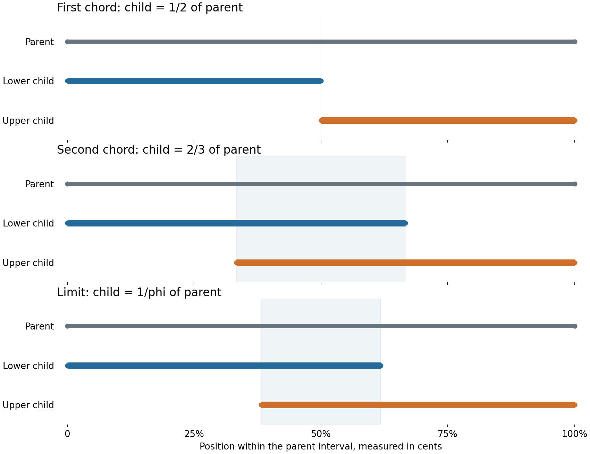
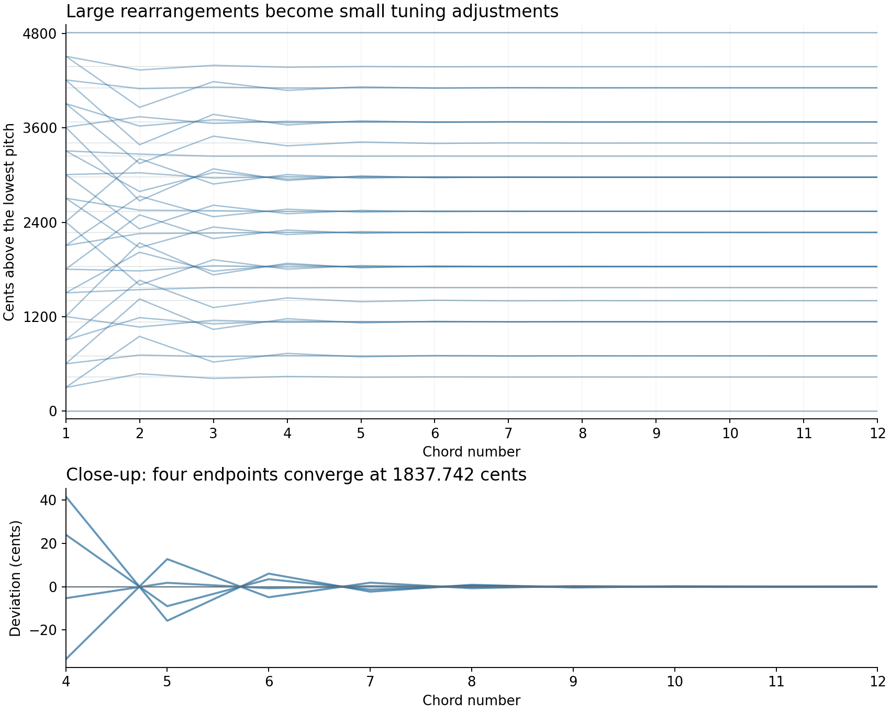
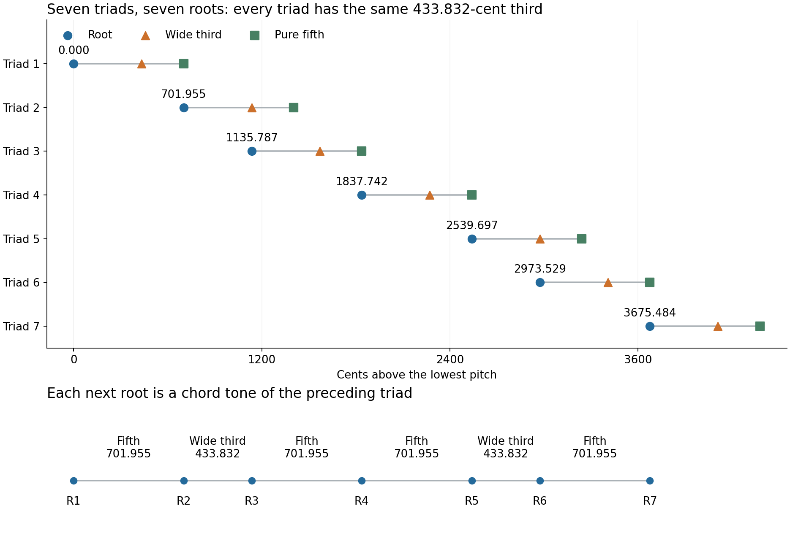
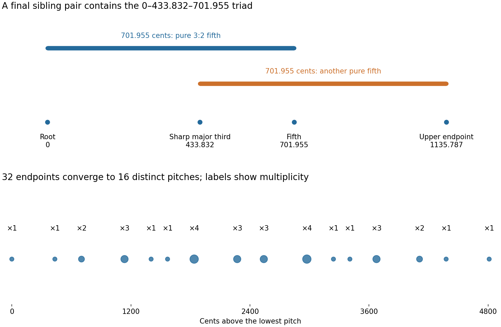
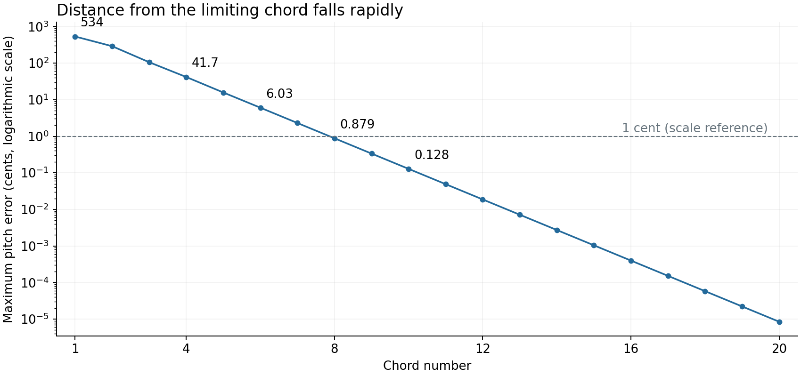

# Calcutta


https://github.com/user-attachments/assets/8ef001a0-f38d-4cdf-892c-0009e6ad3196


Simple whole-number ratios between frequencies give us consonant intervals—but could the sizes of those intervals have meaningful proportions of their own? I wondered whether the golden ratio, familiar from proportions in visual art and musical form, might also turn up between the sizes of consonant intervals in logarithmic pitch space.

If so, there might be a way to approach it through a sequence of chords built from whole-number ratios. Each chord would be a closer approximation, gradually “tuning in” to the destination.

What I found was a weird, sprawling chord containing seven overlapping “major triads.” Their fifths are perfectly in tune. Their thirds are decidedly sharp.

## Building the chord

Start with an interval slightly wider than four octaves: **4811.271 cents**, or 11.271 cents more than four octaves.

Place two smaller intervals inside it, one against each end. Each is the same fraction of the parent's size. Begin with halves, which meet in the middle. For the next chord, use two-thirds, so they overlap. Then three-fifths, five-eighths, eight-thirteenths, and so on: fractions made from neighboring Fibonacci numbers.



Within each chord, repeat this operation four times, keeping the same fraction at every level. That produces 16 small intervals. Play both endpoints of each, and you have the chord: 32 pitch entries, including any doublings.

The Fibonacci ratio compares **interval sizes in cents**. It is a different quantity from a ratio between two notes' frequencies.

## Tuning in

Those Fibonacci fractions approach roughly 0.618—the reciprocal of the golden ratio, φ. They alternate around their destination, making smaller and smaller corrections.

The outer interval was chosen so that four rounds of golden-ratio scaling leave a pure fifth. In compact form: **outer span = pure fifth × φ⁴**. That's where the peculiar 4811.271-cent number comes from.

Early chords make big changes. Later, the motion becomes more like adjusting the tuning of a chord that's already there. Different branches of the construction also arrive at the same pitches: the 32 endpoints eventually coincide at **16 distinct positions**.



By the eighth chord, every pitch is within a cent of its limiting position. Sustained sounds can still reveal small differences as beating. The code continues to 40 chords, stopping at the limits of its numerical precision.

## An unusual family of triads

Each of the seven “major triads” has the same shape: a root, a third **433.832 cents** above it, and a pure fifth **701.955 cents** above it. That third is about 34 cents sharper than an equal-tempered major third, or 48 cents sharper than a pure 5:4 third.

They have **seven different roots**. Climbing from one root to the next, the steps are:

**fifth, wide third, fifth; fifth, wide third, fifth.**

Each next triad therefore grows out of a note of the preceding one. The roots form two copies of the same four-root pattern, sharing their middle root. The construction actually generates eight triad instances, but two land on exactly the same three pitches.



The destination keeps those pure fifths alongside thirds that never become conventional major thirds. What resolves is the motion toward this particular chord—and the clusters arriving at unisons—not all of its harmonic strangeness.

[Listen to the sustained-chord progression](docs/tuning/audio/calcutta.mp3).

The tuning generator lives in [`calcutta.py`](https://github.com/jonathanmarmor/calcutta/blob/master/calcutta.py). The accompanying figures and analysis scripts document the construction and count the triads.


<details>
<summary>More diagrams and exact tuning data</summary>





The [tuning data](docs/tuning/analysis.json) and [triad-root data](docs/tuning/triad_roots.json) give the exact construction and numerical results. To reproduce the figures, install NumPy and Matplotlib, then run:

```sh
python docs/tuning/analyze_tuning.py
python docs/tuning/triad_roots.py
```

</details>


## Run with Python 3

```sh
python -m venv .venv
source .venv/bin/activate
python -m pip install -r requirements.txt
python render.py --seconds-per-chord 4 --output output
```

This exports `calcutta.mid`, `calcutta.wav`, and `calcutta_harmonies.json`.
The original generator's pitches, chord order, and duplicate notes are preserved.
Four seconds per chord is a new listening default, not a timing specified in
the original composition. Use `--seconds-per-chord` to change it.

The MIDI has 32 voices, each on its own port/channel combination, using three
MIDI ports. Every voice sets its pitch-bend sensitivity to +/-2 semitones via
RPN, then applies a separate pitch bend for each chord. Pitch quantization error
is at most 0.0123 cents. Channel 10 is skipped. A DAW must honor the MIDI port
metadata or route the three groups to separate synth instances; collapsing
ports onto one instance causes conflicting bends. Set any synth's bend range
to +/-2 semitones if it does not honor RPN. Program 90 is a suggested warm pad;
the included synth uses its own sound rather than a General MIDI sound bank.

The WAV is synthesized from the exported MIDI using a steady additive tone
(fundamental plus three quieter harmonics), an 80 ms attack and 200 ms release.
It uses no effects or oscillator detuning, so audible beating comes from the
chord tuning. All voices are centered and the full rendering is peak-normalized.
It requires no soundfont. The renderer supports the fixed tempo and bend range
of its own export, not arbitrary external MIDI files.

To make a smaller listening file, install FFmpeg and run:

```sh
ffmpeg -i output/calcutta.wav -codec:a libmp3lame -q:a 2 output/calcutta.mp3
```
